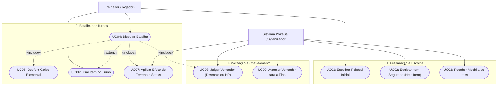

# Diagrama de Casos de Uso - PokeSal

**Projeto:** PokeSal - Simulador de Batalha (UCSal Pituaçu)  
**Notação:** Mermaid (Flowchart)  

---

## Descrição dos Casos de Uso

### 1. Preparação e Escolha
- **UC01 - Escolher Pokésal Inicial:** O treinador escolhe 1 entre as 6 criaturas permitidas (*BulbaSal, CharSal, SquirtSal, ChikoSal, CyndaSal, TotoSal*).
- **UC02 - Equipar Item Segurado (Held Item):** O sistema sorteia e equipa 1 entre os 6 Held Items no Pokésal do competidor.
- **UC03 - Receber Mochila de Itens:** O sistema abastece a mochila do treinador com o kit oficial de 3 itens (*Potion, Super Potion, Antidote*).

### 2. Batalha por Turnos
- **UC04 - Disputar Batalha:** Caso de uso central do combate. A ordem de atuação é definida pela velocidade (SPD).
- **UC05 - Desferir Golpe Elemental (`«include»`):** O Pokésal ataca usando multiplicadores elementais ($2.0\times, 0.5\times, 1.0\times$).
- **UC06 - Usar Item no Turno (`«extend»`):** O treinador opta por usar um item da mochila (consome o turno, limite de 2 por batalha).
- **UC07 - Aplicar Efeito de Terreno e Status (`«include»`):** No fim do turno, o sistema processa efeitos de terreno e status (*Queimado, Envenenado, Paralisado*).

### 3. Finalização e Chaveamento
- **UC08 - Julgar Vencedor (`«include»`):** O combate termina por desmaio (`HP <= 0`) ou pelo limite de 10 turnos (vitória por maior HP restante).
- **UC09 - Avançar Vencedor para a Final:** O vencedor da primeira batalha (semifinal) tem seus atributos restaurados e avança para enfrentar o Mestre Red na Grande Final.
